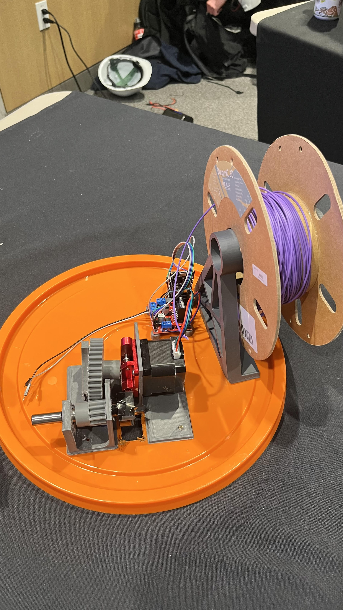

# Pelletizer Controller — ESP32

Stepper motor controller for a recycled plastic pelletizer system, built as part of a 
university engineering showcase project. Controls a cutting/feeding mechanism using an 
ESP32, beam break sensor for automatic material detection, and potentiometer-based 
variable speed control.

## What It Does

- **Beam break automation:** Motor starts automatically when plastic strand is detected, 
  stops when material clears (with configurable hold-off delay to prevent stuttering)
- **Variable speed control:** Potentiometer maps to 6–120 RPM range in real time
- **Master enable:** Push-button arms/disarms the system; motor cannot run unless system 
  is armed
- **Serial diagnostics:** Live status output for beam state, motor state, and RPM

## Hardware

| Component | Details |
|---|---|
| Microcontroller | ESP32 (Arduino-ESP32 core) |
| Stepper Driver | A4988 / TMC2209 (STEP/DIR interface) |
| Stepper Motor | NEMA 17, 1.8°/step (200 steps/rev) |
| Microstepping | 16x (3200 steps/rev) |
| Beam Sensor | Adafruit #2167 or equivalent IR break-beam |
| Speed Control | 10kΩ potentiometer |
| Input | Momentary push-button (active LOW) |

## Wiring

| ESP32 Pin | Connects To |
|---|---|
| GPIO 26 | STEP (driver) |
| GPIO 27 | DIR (driver) |
| GPIO 14 | ENA (driver, active LOW) |
| GPIO 34 | Potentiometer wiper |
| GPIO 18 | Start/Stop button (other leg to GND) |
| GPIO 19 | Beam break sensor output |

Full wiring diagram in the source file header.

## Dependencies

- [AccelStepper](https://www.airspayce.com/mikem/arduino/AccelStepper/) — install via 
  Arduino Library Manager

## Configuration

Key constants at the top of the file you may need to change:

```cpp
constexpr uint8_t  BEAM_ACTIVE_STATE     = LOW;   // Flip to HIGH if your sensor is inverted
constexpr uint32_t BEAM_CLEAR_HOLDOFF_MS = 300;   // Increase if motor stutters between pellets
constexpr uint8_t  MICROSTEPS            = 16;    // Match your driver MS pin settings
constexpr float    MIN_SPEED             = 320.0f; // steps/s (~6 RPM)
constexpr float    MAX_SPEED             = 6400.0f; // steps/s (~120 RPM)
```

## How to Flash

1. Install [Arduino IDE](https://www.arduino.cc/en/software) with the 
   [ESP32 board package](https://docs.espressif.com/projects/arduino-esp32/en/latest/installing.html)
2. Install AccelStepper via Library Manager
3. Open `pelletizer_controller.ino`
4. Select board: **ESP32 Dev Module**
5. Upload and open Serial Monitor at **115200 baud**

## System Logic
Button pressed → masterEnabled toggles ON/OFF
masterEnabled = OFF → motor always stopped
masterEnabled = ON  → beam break controls motor:
Beam BROKEN  (plastic present) → motor runs at pot-set speed
Beam CLEAR   (no plastic)      → wait 300ms → motor stops
## Project Context

Built for a recycled plastic pelletizer designed and fabricated at Western University. 
The system processes reclaimed plastic material by automatically controlling the 
cutter feed mechanism based on material presence detection.

